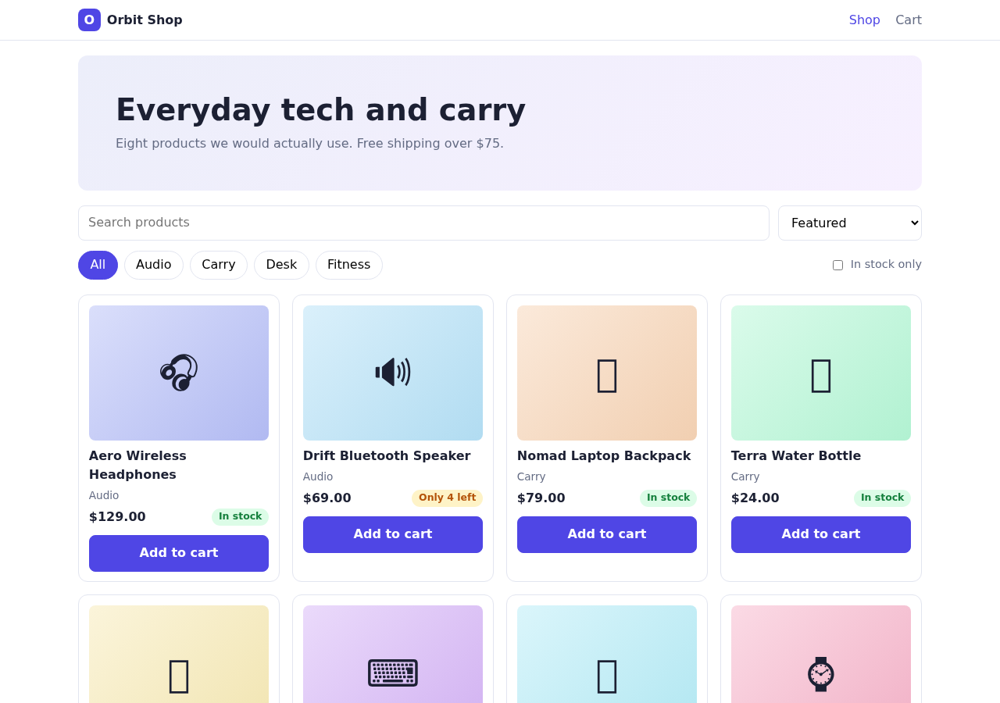
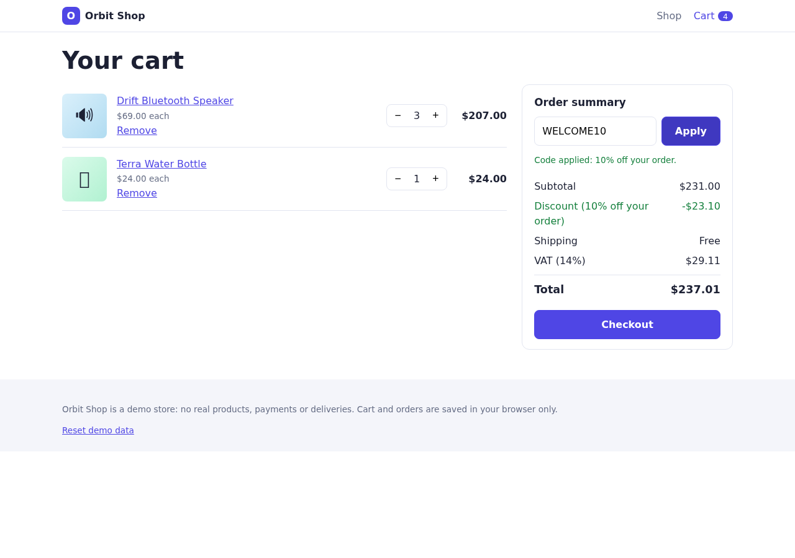

# Orbit Shop: a small online store

A demo storefront: browse products, build a cart, check out, get an order confirmation. It is the shop side of the "Orbit" pair; the back office is [Orbit Admin](https://github.com/abdoshawky1/orbit-admin).

**Live demo:** _add link after deploy_




## What it does

- **Shop:** search, category chips, sort, "in stock only". Filters live in the URL, so a filtered view survives refresh and can be shared.
- **Product page:** price, stock status ("Only 3 left", "Sold out"), quantity picker limited to what is still available.
- **Cart:** change quantity, remove, promo codes (`WELCOME10` for 10% off, `FREESHIP`), a hint when you are close to free shipping.
- **Checkout:** delivery form with clear field errors, then an order confirmation with a reference like `OS-A5YWYT`.
- **Stock is real inside the demo:** buying reduces stock, and a cart can never hold more than what is in stock.
- **Phone friendly:** the cart and checkout stack on small screens.

## How it works

- **Money is integer cents.** No floats, so `0.1 + 0.2` style rounding bugs cannot reach a total. Discount and VAT are rounded once, to whole cents.
- **Cart logic is separate from the UI** (`src/lib/cart.js`) and tested: adding beyond stock, clamping quantities, shipping thresholds, promo codes, VAT, empty cart, purchase refused if stock ran short.
- **The cart stores only `{ id, qty }`.** Prices and stock are looked up when totals are calculated, so a cart can never hold a stale price.
- **Order of calculation:** subtotal, then discount, then shipping (free from $75 after discount, or with `FREESHIP`), then 14% VAT on the discounted amount.
- **Checkout validates Egyptian mobile numbers** (`010 1234 5678`, `+20 10 ...`, `0020 ...`) and stores one normalised form.
- **Placing an order checks stock again** and refuses if an item sold out meanwhile.
- **React + Vite + React Router.** No UI or state library.

## Tradeoffs and what I would do next

- **No backend.** Cart, stock and orders are in localStorage, so nothing is shared between devices or users. A real shop needs an API and a database, and stock must be checked on the server.
- **No online payment.** Checkout is cash on delivery on purpose: the demo never asks for card details. Real payments would go through a provider such as Stripe, never through my own form.
- **Product images are emoji tiles**, not photos.
- **Promo codes are checked in the browser**, so anyone can read them. Real codes are validated on a server.
- **Next:** order history page, product reviews, a real backend, and component tests (only the logic is tested now).

## Run it locally

```bash
npm install
npm run dev      # http://localhost:5173
npm test         # 24 tests on the logic in src/lib
npm run build
```

## Structure

```
src/
  pages/        Shop, Product, Cart, Checkout, Confirmation
  components/   Layout, ProductCard, ProductImage, Summary
  hooks/        useStore (cart, stock, orders + localStorage)
  lib/          cart, catalog, checkout, money (+ tests)
  data/         product catalogue
```
